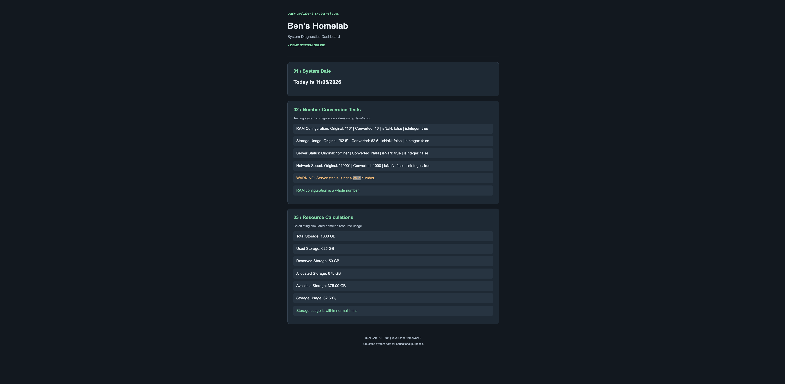

# Ben's Homelab | System Diagnostics

## CIT 384 - Homework 9: JavaScript Built-In Objects

### Project Overview

This project is a simple JavaScript webpage designed to look like a homelab system diagnostics dashboard. It demonstrates how JavaScript built-in objects can be used to display the current date, convert and validate numbers, perform calculations, and display results on a webpage.

The dashboard uses simulated system information for educational purposes.

## JavaScript Objects and Methods Used

- `Date()` - Creates a Date object containing the current date.
- `getMonth()` - Gets the current month.
- `getDate()` - Gets the current day.
- `getFullYear()` - Gets the current year.
- `String()` - Converts values into strings.
- `padStart()` - Adds leading zeros to the month and day.
- `Number()` - Converts strings into numeric values.
- `Number.isNaN()` - Checks whether a converted value is NaN.
- `Number.isInteger()` - Checks whether a number is an integer.
- `toFixed(2)` - Formats numeric results to two decimal places.
- `document.getElementById()` - Selects HTML elements to display JavaScript results.
- `textContent` and `innerHTML` - Updates content displayed on the webpage.

## Project Features

1. Displays the current date in MM/DD/YYYY format.
2. Converts four different string values into numbers.
3. Checks whether converted values are NaN or integers.
4. Performs addition, subtraction, multiplication, and division.
5. Formats calculated results using `toFixed(2)`.
6. Uses `if/else` statements to display validation and storage status messages.
7. Uses CSS to create a dark-themed dashboard.

## GitHub Pages

**Live Website:** https://benji2803.github.io/hw9/

**GitHub Repository:** https://github.com/benji2803/hw9

## Screenshot

## Reflection

**1. What part was easiest?**

The easiest part was creating the HTML sections and using CSS to style the dashboard because I was already familiar with HTML and CSS from previous assignments.

**2. What part was hardest?**

The hardest part was understanding how JavaScript converts strings into numbers and how to check whether the results are valid numbers or integers.

**3. What did you learn about the Date object?**

I learned that the Date object can retrieve the current date and that JavaScript months start at zero, so I need to add one to get the correct month.

**4. What did you learn about the Number object?**

I learned that the Number object can convert strings into numeric values and that methods such as `Number.isNaN()` and `Number.isInteger()` can validate the results.

**5. What did you learn about displaying results in the browser?**

I learned how to use `document.getElementById()`, `textContent`, and `innerHTML` to display JavaScript results directly on a webpage instead of only showing them in the browser console.

## Notes

All system metrics are simulated and do not represent actual live server information.